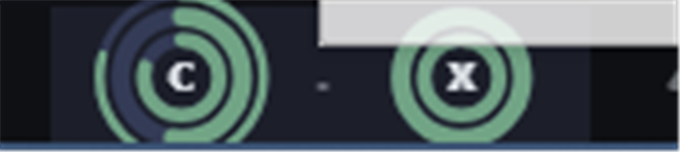

# Model Usage — Hermes Desktop plugin

Claude / Codex subscription usage at a glance in the Hermes Desktop status bar.



- One **triple-ring gauge** per provider: outer thin ring = context window of the current chat, middle = 5-hour session window, inner = weekly window, provider letter in the middle (`C` Claude, `X` Codex).
- **Limit alerts**: when a 5h or weekly window drops to 30% and again to 10% remaining, one in-app toast plus one Windows/OS notification (shown only while Hermes is not focused). Each threshold fires once per window period.
- Color by **remaining** share: >50% green · 31–50% yellow · 11–30% orange · ≤10% red.
- Click → popover with every window as a bar plus reset countdown. Duplicate pool rows of the same login are merged.
- Gemini: link to Google AI Studio usage (Hermes has no Gemini usage API).
- Read-only: uses the gateway `model.options` usage cache; never touches credentials. Refreshes every minute.
- UI strings: English, 한국어, 日本語.

## Install

```bash
hermes plugins install Mirinai307/hermes-plugin-model-usage
```

Then open **Capabilities → Plugins** in Hermes Desktop and switch **Model Usage** on (desktop halves install disabled).

## License

MIT

## Disclosure

- No network calls of its own: usage comes from the Hermes gateway (`model.options`, the same cache the model picker uses) and the focused chat's usage stats.
- Never reads, stores or sends credentials. No shell commands, no background processes, no telemetry.
- Stores only the list of alerts already shown (plugin storage) so each threshold fires once per window.
- The Gemini row opens `https://aistudio.google.com/usage` in your browser when clicked.
- Works on Windows, macOS and Linux (pure desktop SDK, no Python).
